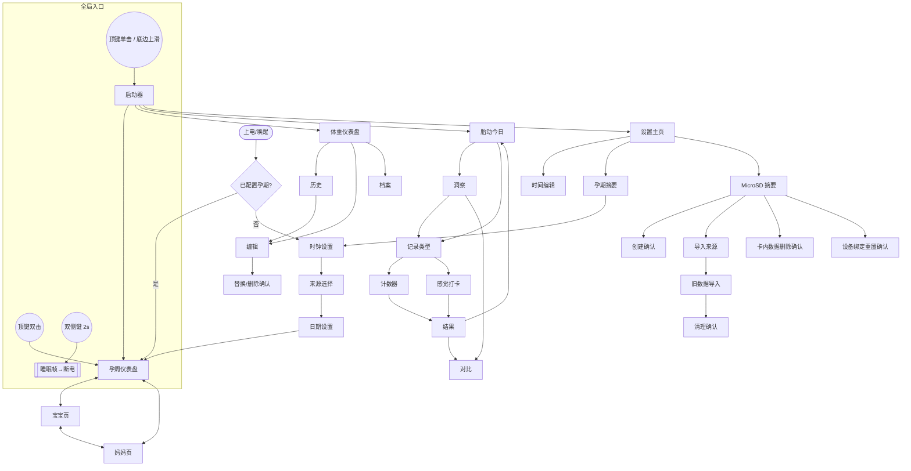

# UI/UX 现状审计

审计日期：2026-10-15。范围：只读调研，未修改任何 UI 或业务代码。
依据：当前仓库源码（以代码为准），辅以 `DESIGN.md`、`docs/PAGE-STRUCTURE.md`、`docs/EINK_UI_*.md`。
代码里查不到的信息一律标注 **【待确认】**，不做猜测。

---

## 0. 硬件与代码现状（第一步结论）

### 0.1 屏幕与驱动

| 项 | 结论 | 来源 |
| --- | --- | --- |
| 设备 | Seeed Studio reTerminal Sticky，ESP32-S3（8 MB PSRAM，32 MB Flash） | `docs/HARDWARE-REFERENCE.md`、`boards/sticky_esp32s3.json` |
| 屏幕 | 3.97 英寸，物理 800×480，官方标称 235 ppi、4 级灰阶 | `docs/HARDWARE-REFERENCE.md`（官方资料转述） |
| 屏幕厂商/面板型号 | **【待确认】** 仓库只记录了控制器，没有面板料号 | — |
| 控制器 | SSD1677 | `components/seeed_epaper/driver/ssd1677.c` |
| 驱动库 | 自带组件 `components/seeed_epaper`（`epaper_panel.c/.h` + `driver/ssd1677.c`），SPI2，与 MicroSD 共用总线 | `src/display/sticky_display.cpp:7-8` |
| 物理安装方向 | 面板装配相对逻辑画面旋转 180°，显示层在每次刷新前整帧旋转 | `sticky_display.cpp` `rotate_framebuffer_180` |
| 逻辑画布 | 800×480 横屏 / 480×800 竖屏，左上角为原点，由 IMU 稳定方向决定 | `src/ui/canvas.h`、`src/app/sticky_app_display_orientation.cpp` |
| 帧缓冲格式 | Canvas 内部是 **2 bit/像素 4 级灰阶**（Black=0、DarkGray=1、LightGray=2、White=3） | `canvas.h` `GrayLevel` |
| **实际送屏灰阶** | **1-bit 黑白**。局刷/全刷路径把灰度 0/1 → 黑，2/3 → 白（阈值转换）。`sticky_display_refresh()`（4 级灰阶路径）全工程**没有任何产品页面调用** | `sticky_display.cpp` `convert_gray4_to_monochrome_in_place`；调用点见 §0.2 |

> 直接后果：`LightGray` 画的任何线/边框在真机上必然消失；`DarkGray` 文字只有完整覆盖的像素能保留。（`docs/EINK_UI_CURRENT_ANALYSIS.md` 已有相同结论。）

### 0.2 全刷 / 局刷

**显示层 API**（`src/display/sticky_display.h`，实现 `sticky_display.cpp`）

| API | 实际行为 |
| --- | --- |
| `sticky_display_refresh_monochrome()` | 全屏黑白**全刷**（`refresh_full_frame`，实测约 2000 ms：`docs/EINK_UI_REAL_DEVICE_TEST.md:214-216`） |
| `sticky_display_refresh_partial()` | 黑白**局刷**。每次都发送**整帧**对比帧（SSD1677 局刷波形作用于全屏），不是真正的“只刷局部窗口” |
| `sticky_display_refresh()` | 4 级灰阶全刷；**无产品调用** |
| `sticky_display_clear()` | 白屏全刷，仅冷启动用（`main.cpp:296`） |
| `sticky_display_prepare_app_transition_refresh()` | “APP 切换快刷，每 5 次一次全刷清理”。**全工程没有调用点**（只有 `cancel` 在 `sticky_app.cpp:363` 被调用），属于死代码，快刷分支永远不会触发 |

**局刷计数 / 强制全刷**：有，且在显示层兜底。

- `kPartialRefreshesBeforeCleanup = 8`（`sticky_display.cpp:35`）。连续局刷 ≥ 8 次后，下一次 `refresh_partial()` 自动提升为全刷（`sticky_display.cpp:241-248`，日志 `reason=partial_limit`）。任意一次全刷/灰阶刷/清屏都会把计数清零。
- 面板组件层另有保护：基线全刷之前请求局刷会被提升为全刷（`epaper_panel.c:208-210`）。
- 胎动页自己还有一份独立的 8 次计数（`kick_app.cpp:42,118-122`），与显示层重复。
- 睡眠前必定做一次全刷（`sticky_app.cpp:364`），随后切断屏幕供电；掉电后画面保持。
- 电池状态叠加层在每次刷新前由显示层绘制（`draw_battery_overlay_if_enabled`），各 App 渲染时先把它关掉，仅睡眠帧和孕周页横屏紧凑电量图标使用。

**各调用点的刷新时机**

| 调用方 | 全刷（~2 s 闪烁） | 局刷 |
| --- | --- | --- |
| 启动器 `render_launcher` (`sticky_app.cpp:183-193`) | 方向切换（`render_launcher(true)`） | **打开启动器、语言切换均为局刷**（默认参数 `false`） |
| 孕周 `render_page` (`pregnancy_app.cpp:203`) | 进入/恢复/存储状态变化（`render_page(false)`） | **所有触摸动作**（`render_page(true)`，`:562`）包括切换 Baby/Mom/Dashboard 整页 |
| 体重 `render` (`weight_app.cpp:182`) | 页面变化（`page != page_before`）、存储变化 | 同页内改数值 |
| 胎动 `render` (`kick_app.cpp:324`) | 页面变化、存储变化 | 同页内计数；计数页每 8 次局刷自带全刷 |
| 设置 `render` (`settings_app.cpp:299`) | 少数动作（刷新屏幕、安全弹出、存储事件、偏好变化） | **大多数页面跳转为局刷**（`open_editor(); render();` 等，`:415-430`） |
| 睡眠 | 一律全刷 | — |

→ 四个 App 的“页面切换用全刷还是局刷”策略互相矛盾，见问题 E1。

### 0.3 输入方式与事件入口

| 输入 | 驱动 | 事件入口 |
| --- | --- | --- |
| 电容触摸 GT911（I2C0，30 ms 轮询，轻触容差 24 px） | `components/gt911`、`src/input/sticky_touch.cpp` | `sticky_touch_take_press()`（轻触，物理坐标）、`sticky_touch_take_interaction()`（完整轨迹，用于滑动）。坐标由 `Canvas::physical_to_logical()` 转为逻辑坐标 |
| 顶部 AI 键 GPIO4 | `src/input/sticky_button.cpp` | `sticky_button_take_event()`：单击 → 开关启动器；双击 → 回孕周首页 |
| 侧面两键 GPIO5/6 | 同上 | 同时按住 2 s → `SleepChord` 深度睡眠 |
| 手势 | `src/app/sticky_app_gesture.cpp` | 底边（最下 1/8）上滑 → 打开启动器；启动器内下滑（起点在上 70%）→ 关闭 |
| 实体旋钮 | 无 | — |
| IMU 方向 | `src/sensors`、`sticky_app_display_orientation.cpp` | 稳定后触发整页重新渲染 |

全局分发在 `src/app/sticky_app.cpp` 的 `app_task`（约 `:440-520`）：处理按键、手势、启动器内触摸；启动器关闭时，触摸由各 App 自己的任务通过 `sticky_touch_take_press()` 取走并做命中测试。

### 0.4 UI 代码目录

| 层 | 位置 |
| --- | --- |
| 绘图层 | `src/ui/canvas.*`（像素/线/矩形/圆/文本，自动裁剪）、`src/ui/font.*`、`src/ui/text_layout.*` |
| 通用组件 | `src/ui/prototype_ui.*`（Rect、`draw_button`、`draw_header`、`draw_chevron`、状态方块）、`src/ui/repository_status_page.*`、`src/ui/battery_status_overlay*`、`src/ui/chinese_input_page.*` |
| 设计令牌 | `src/ui/ui_tokens.h`（字号、边距、触控高度、线宽） |
| 启动器页面 | `src/ui/app_pages.cpp` |
| App 页面 | `src/apps/<app>/<app>_pages.*`（渲染 + 命中测试）；`<app>_app.cpp`（状态机、刷新调用、触摸取走） |
| 字体 | `src/ui/font.cpp` 5×7 点阵 + `src/ui/assets/chinese_font_assets.cpp`（生成，597 字 × 2 字重，32×32 母版运行时缩放）、`chinese_input_font_assets.cpp`（输入法字体）。生成器 `tools/generate_chinese_font_assets.py` |
| 图标 / 图片 | 多数语义图标用 `draw_line/draw_circle` 现场画（`pregnancy_pages.cpp:172-221`）；启动器贴纸、孕周 148×148 1-bit 插图在 `assets/` → `tools/generate_*.py` → `src/ui/assets/*.cpp` |
| 多语言 | `src/ui/ui_language.*`（英/简中，`ui_text("KEY")` 查表） |
| 刷新 / 驱动（不属于 UI） | `src/display/`、`components/seeed_epaper/`、`src/board/` |

### 0.5 UI 框架与电脑预览

- **没有使用 LVGL 或任何第三方 UI 框架**，是自研的立即模式绘图层（`Canvas` + 各页面 `render` 函数 + 配套 `*_action_at` 命中函数）。
- **电脑上预览已经部分可行**：页面渲染函数只依赖 `Canvas`，不依赖硬件，`tools/run_host_tests.sh` 用 `g++` 把它们编进宿主测试，且 `test/kick_pages_test.cpp:14-26`（`write_preview`）已经能把 Canvas 写成 PPM 图像；`test/*_pages_test.cpp`（weight / settings / pregnancy / app_launcher / font_test_screen 等）同样可驱动渲染。
- 现有 `design/eink-ui-optimization/prototype-*.html` 是 HTML 手绘原型，**与真实渲染代码没有联动**，不可当作真实预览。
- 本机已具备：`g++`、`python3` + Pillow 11.3、`node`。

---

## 1. 页面清单

> 说明：“全/局”指进入该页时的刷新方式（读代码所得）；括号内为代码依据。
> 所有 App 横竖屏各有一套布局（`portrait` 分支），下表不重复。

### 1.1 全局

| 页面 | 用途 | 入口 | 主要元素 | 刷新 |
| --- | --- | --- | --- | --- |
| 启动器 | 选择 4 个 App | 顶键单击 / 底边上滑 / App 内“菜单”图标 | 标题“功能/APPS”、副标题(14px)、关闭按钮、4 张卡片（序号+名称+摘要+箭头+下划线）、底部提示(14px) | **局刷**（方向变化时全刷） |
| 睡眠帧 | 深睡前静态画面 | 30 s/60 s/3 min 无操作，或双侧键 | 当前页面 + 右上睡眠图标 + 电量 | 全刷，然后断电 |

### 1.2 孕周（Baby Week）`src/apps/pregnancy`

| 页面 | 用途 | 入口 | 主要元素 | 刷新 |
| --- | --- | --- | --- | --- |
| 时钟设置 | 首次使用输入 RTC `YYYYMMDDHHMM` | 首次启动 / 设置 | 标题、输入框、12 键数字键盘(84×66 / 132×72)、Cancel/Next | 进入全刷，按键局刷 |
| 来源选择 | 选预产期或末次月经 | 时钟设置之后 | 2 张大卡片(320×170)、可选返回 | 同上 |
| 日期设置 | 输入 `YYYYMMDD` | 来源选择 | 同时钟设置 | 同上 |
| 仪表盘 | 孕周/天、三期、预产期倒计时、进度条、周大小插图、“本周成长”卡片 | 默认首页、顶键双击 | 大号“孕 N 周”(52/56px)、进度条、倒计时、插图、成长卡片(14px 文字)、右上菜单图标 | 进入全刷，切页局刷 |
| 宝宝 / 妈妈 | 本周发育 / 身体变化文字 | 点仪表盘插图或故事行 | 标题、正文、底部 3 个 Tab（总览/宝宝/妈妈） | 局刷 |
| 存储状态 | MicroSD 缺失/只读/加载中 | 存储异常 | 状态文案 + 重试按钮 | 同上 |

### 1.3 体重 `src/apps/weight`

| 页面 | 用途 | 入口 | 主要元素 | 刷新 |
| --- | --- | --- | --- | --- |
| 仪表盘 | 最新值、较基线变化、7/30 天折线 | 启动器 | KG/LB 切换、趋势切换、折线图、底部 3 按钮（记录/历史/档案） | 进入全刷 |
| 历史 | 分页 5 行，点击进入编辑 | 仪表盘 | 行列表、上一页/下一页、返回 | 页变全刷 |
| 编辑 | 加减数值保存 | 仪表盘“记录”/历史行 | 数值、±1 / ±0.1 四键、保存、取消、删除 | 页变全刷，加减局刷 |
| 替换 / 删除确认 | 同日覆盖、删除 | 编辑 | 日期文案 + 确认/取消 | 页变全刷 |
| 档案 | 身高、基线 | 仪表盘 | 加减键、保存 | 页变全刷 |

### 1.4 胎动 `src/apps/kick`

| 页面 | 用途 | 入口 | 主要元素 | 刷新 |
| --- | --- | --- | --- | --- |
| 今日 | 今日总数、时段、最近一次 | 启动器 | 汇总、开始、洞察、返回 | 进入全刷 |
| 洞察 | 近 7 天柱状图 | 今日 | 柱+14px 数字、开始/对比 | 页变全刷 |
| 记录类型 | 1 小时 / 数到 10 / 感觉打卡 | 开始 | 3 个选项 | 页变全刷 |
| 计数器 | 计时、计数 | 选类型 | 大圆(r=112/128)+70px 数字、已计时、撤销、完成、取消 | 页变全刷，**每次点按局刷** |
| 感觉打卡 | 4 选 1 保存 | 选类型 | 4 个选项 | 页变全刷 |
| 结果 | 本次与 7 日中位数对比 | 完成/数到 10 | 对比文字、完成/对比 | 页变全刷 |
| 对比 | 分时段对比、打卡汇总 | 今日/结果 | 多行文字 | 页变全刷 |

### 1.5 设置 `src/apps/settings`

| 页面 | 用途 | 入口 | 刷新 |
| --- | --- | --- | --- |
| 主页 | 语言、时间、孕期摘要、刷新屏幕、MicroSD | 启动器 | 进入全刷 |
| 时间编辑 | 12 位数字键盘 | 主页 | **局刷**（整页换版） |
| 孕期摘要 | 来源、预产期、进度 | 主页 | **局刷** |
| MicroSD 摘要 | 状态、容量、初始化/弹出/管理 | 主页 | **局刷** |
| MicroSD 创建确认 / 导入来源选择 / 旧数据导入 / 旧数据清理确认 / 卡内数据删除确认 / 设备绑定重置确认 | 存储维护流程 | MicroSD 摘要 | 以局刷为主 |

### 1.6 未启用 / 非产品页面

- **提醒（Reminder）、产检（Checkup）**：源码仍在（`src/apps/reminder`、`src/apps/checkup`，`CMakeLists` 里仍编译），但未在 `app_registry.cpp` 注册，用户不可达。
- **中文输入页** `src/ui/chinese_input_page.*`：仅被 `sticky_chinese_input_test` 使用，产品页面未接入。
- 各类 `*_test_pages`、字体测试屏：仅调试环境。

---

## 2. 导航结构图

其他全局规则：启动器 30 s 无操作自动关闭；各 App 返回键最终都是 `sticky_app_request_launcher()`（回启动器，而不是回上一级 App 页）；设置 → 孕期摘要 → 编辑会跳回孕周的设置流程。

---

## 3. 核心任务的操作路径

计数口径：一次触摸或一次按键算 1 步，数字键盘按键逐个计。

| 任务 | 路径 | 步数 |
| --- | --- | --- |
| 看本周宝宝发育 | 首页点插图 | 1 |
| 回首页 | 顶键双击 | 1 |
| 记一次胎动（数到 10） | 顶键 → 点“胎动” → 开始 → 选“数到10” → 点圆 ×10（第 10 次自动保存） → 结果页“完成” | **4 步进入 + 10 次计数 + 1 步收尾**；其中每次计数一次局刷 |
| 感觉打卡 | 顶键 → 胎动 → 开始 → 感觉 → 选项（即保存） | 5 |
| 记录今日体重 | 顶键 → 体重 → 记录 → 调数值（默认取最近一次，差 3.4 kg 需 +1×3、+0.1×4 共 7 次）→ 保存（若今日已有记录再多一次确认） | 3 + 调值 + 1 |
| 改语言 | 顶键 → 设置 → 语言按钮（启动器本身的语言按钮是空实现，`app_pages.cpp:99-105`） | 3 |
| 校准时间 | 顶键 → 设置 → 时间 → 12 位数字 → 保存 | 3 + 12 + 1 = 16 |
| 初始化 SD 卡 | 顶键 → 设置 → MicroSD → 初始化 → 确认页 → 确认 | 5 |
| 清屏去残影 | 顶键 → 设置 → “刷新屏幕” | 3 |

观察：所有 App 切换都要经过“启动器”这一层（两次点按、两次刷新），没有 App 之间的直达；高频任务（胎动、体重）路径都是 3~4 步起步。

---

## 4. 问题清单

严重程度：**高**＝影响可用性或屏幕寿命/体验的主要问题；**中**＝明显缺陷；**低**＝打磨项。

### 4.1 墨水屏特有问题

| # | 问题 | 位置 | 严重 |
| --- | --- | --- | --- |
| E1 | **【已修复，待实机复测，2026-10-15】** 原问题：**页面切换刷新策略四处不一致**。体重/胎动：页变 → 全刷(~2 s 整屏闪黑)；设置：整页换版(主页→时间编辑→MicroSD…)大多只局刷；孕周：Dashboard↔Baby↔Mom 全部局刷；启动器打开也是局刷。整页内容替换用局刷会产生严重残影，而同类操作在别的 App 却用全刷，用户体验和残影风险都不可预测 | `weight_app.cpp:182`、`kick_app.cpp:324`、`settings_app.cpp:299,415-430`、`pregnancy_app.cpp:562`、`sticky_app.cpp:183-193` | **高** |
| E2 | **“局刷”其实是整帧发送+全屏波形**，8 次上限只是计数，不是按面积或内容变化量判断；整页换版（变化面积近 100%）和一个数字变化（<1%）被同等计入，且没有任何“脏区”信息被使用 | `sticky_display.cpp:236-281` | **高** |
| E3 | 胎动计数页**每次点按 = 一次整屏局刷**，约 8 次后必然出现一次约 2 s 的全刷闪烁，正好发生在用户连续点按的中途，且计数点按过程中无即时反馈（局刷本身延迟） | `kick_app.cpp:116-124`，`kick_pages.cpp:342-` | **高** |
| E4 | 灰阶设计与 1-bit 输出不匹配：`LightGray` 画的边线在送屏阈值处理后**一定消失**，`DarkGray` 只剩全覆盖像素；代码里仍保留 4 级灰阶抽象（`GrayLevel`），页面代码虽多已改用 Black/White，但仍存在灰阶依赖（电池叠加主题按 `<= DarkGray` 采样判断背景色）。字体来自 32×32 母版**运行时缩放**，小字号笔画粗细不均（`EINK_UI_CURRENT_ANALYSIS.md`） | `convert_gray4_to_monochrome_in_place`、`battery_status_overlay_theme.cpp:32`、`ui/font.cpp` | 中 |
| E5 | 显示层有“APP 切换快刷”机制但**从未被调用**，实际每次 App 切换/恢复都是 ~2 s 全刷。文档（`docs/pregnancy/eink-refresh-strategy.md`）声称“App 切换使用快刷，5 次后清理”，与代码不符 | `sticky_display.cpp:335-350`，无调用点 | 中 |
| E6 | **【已修复】** 原问题：启动器打开用局刷：从任意 App 页切到启动器相当于整页换版，局刷残影风险高；而从启动器进 App 又是全刷 | `sticky_app.cpp:183-193,200-212` | 中 |
| E7 | **【已修复】** 原问题：胎动页自带第二份“8 次”局刷计数（`s_partial_refreshes`），与显示层 `s_partial_refresh_count_since_full` 重复且互不感知，两处阈值无法统一调整 | `kick_app.cpp:42,118-122` | 低 |
| E8 | 仪表盘整页分层精细（进度条圆角胶囊、圆角成长卡片、斜切角框、14 px 小字），在 1-bit 屏上细节过多；圆角/斜切全靠逐线绘制，1 px 描边在真机上视觉很弱 | `pregnancy_pages.cpp:98-170,374-556` | 中 |
| E9 | 睡眠前必做一次 ~2 s 全刷，这是合理的；但没有“局刷累计后在睡眠帧顺便清理”的联动逻辑（睡眠前反正要全刷，可不必在之前提前触发清理全刷）。**【待确认】**是否可接受调整 | `sticky_app.cpp:364` | 低 |

### 4.2 交互问题

| # | 问题 | 位置 | 严重 |
| --- | --- | --- | --- |
| I1 | **【已缓解，待实机复测，2026-10-15】** 新增底边横滑（启动器关闭时）直达相邻 App：左滑下一个、右滑上一个，顺序同启动器并首尾相接，高频切换由“顶键 → 点卡片”两次点按两次刷新降为一次滑动一次刷新；启动器仍是主入口，该手势无屏幕提示。侧键因在 `src/input`（约定不可改）未采用。原问题：**所有 App 切换必须经启动器**，没有直达；高频任务（胎动、体重）每次都是 顶键→点 App 起步。启动器只有 4 项，却占一整页并占用两次刷新 | `sticky_app.cpp` 全局分发、`app_pages.cpp` | 高 |
| I2 | **【已修复，待实机复测，2026-10-15】** 仪表盘改为“本周成长”卡片内三行可见入口（带箭头和分隔线：宝宝发育→宝宝页，妈妈变化与每日提示→妈妈页），菜单画成与命中区同尺寸的 56 px 方框；插图和卡片标题不再是隐形按钮；绘制与命中共用同一组 `Rect`。原问题：**孕周仪表盘的可点区域没有视觉提示**：整张插图(368×440)、故事行(352×124 / 352×56)都是隐形按钮，“宝宝/妈妈”入口没有按钮样式；真正有按钮边框的是右上 32×32 菜单图标，但它的命中区是 56×56，图标与命中区尺寸不一致 | `pregnancy_pages.cpp:55-62,467,731-738` | 高 |
| I3 | **【已修复，待实机复测，2026-10-15】** 换页类点按先画按下态并局刷一次（`src/ui/press_feedback.h`，孕周/体重/胎动/设置/启动器）；体重的单位与 7/30 日开关改为分段开关（当前项反色）。页内点按（计数、加减、数字键）不加按下态，其自身的局刷就是反馈。原问题：**点按没有按下态/即时反馈**，局刷延迟下用户无法确认触摸是否被接收；多数页面也没有“选中态”（体重编辑 ±键、胎动计数圆等只有结果出现后才变化） | 各 `*_app.cpp` handle 函数 | 高 |
| I4 | **【已修复，待实机复测，2026-10-15】** 时间/日期输入改为分段字段（`src/ui/digit_fields.*`）：点年/月/日/时/分任一段只改该段（改分钟约 3 次点按而不是 12 次）、当前段反色、填满自动跳下一段、不可能的数字（月 13、时 25…）输入时即被拒绝、DEL 先清当前段再退到上一段；孕周时钟/预产期/末次月经与设置时间编辑共用。原问题：数字输入统一用 12 键键盘逐位输入 12 位时间 `YYYYMMDDHHMM`（16 步），无格式分段高亮、无逐位错误提示，输入错误要到最后才报 | `settings_app.cpp` 时间编辑、`pregnancy_pages.cpp:261-310` | 中 |
| I5 | **【已修复，待实机复测，2026-10-15】** 页头动作统一为 APPS（根页面→启动器）/BACK（上一级）/CANCEL（放弃输入）/HOME（孕周首页）；体重、胎动、设置三个 App 的返回图抽成纯函数并有宿主测试；设置主页的返回由“回孕周”改为回启动器（与体重、胎动一致）；胎动“感觉打卡”返回到“选择记录方式”、“对比”页返回到打开它的页面（趋势或结果），原来都直接回今日页；删除无用的 `PregnancyAction::Edit`。原问题：“返回”语义不统一：多数子页返回→启动器(`sticky_app_request_launcher()`)而非上一级；孕周详情页的“编辑”矩形实际执行“总览”；头部返回按钮文案不统一（`draw_header` 调用处出现 BACK ×5、CANCEL ×2） | `pregnancy_pages.cpp:57,735`，`prototype_ui.cpp:draw_header`，各 app handle | 中 |
| I6 | 启动器的语言切换按钮是空实现(永远返回 false)，但调用链仍保留；教程图标命中函数也只为 Debug 构建 | `app_pages.cpp:99-105,123`，`sticky_app.cpp:404` | 低 |
| I7 | **【部分解决，2026-10-15】** 长按连加无法在 UI 层做：触摸驱动只在抬手后上报点按（`src/input` 不可改），且连续局刷会很快触发 8 次全刷。改为减少点按：基线页的身高改为 −5/−1/+1/+5 cm、基线体重改为 −1.0/−0.1/+0.1/+1.0 kg（原来只有 ±1 cm 和 ±0.1 kg，从 60.0 到 64.0 kg 要点 40 次，现在 4 次）；体重编辑页没有任何记录时，起始值取档案里的基线体重而不是固定 60.0 kg。原问题：体重编辑只有 ±1.0 / ±0.1 四个按钮，没有长按连加；与最近值差距大时需多次点按（每次点按一次局刷） | `weight_pages.cpp` `adjustment()`、`weight_app.cpp:141-147` | 中 |
| I8 | **【已缓解，待实机复测，2026-10-15】** MicroSD 页只留只读状态（内存卡、写入状态、卡上的数据、剩余空间）和两个按钮（初始化/安全弹出、更多）；删除卡内数据和重置设备连接不再藏在“状态行点一下”里，与“导入原设备记录”一起放进新的“更多选项”页，行内写明作用，不可用的行标注“不可用”且不可点；导入来源选择页并入该页（导入深度不变，删除多一层以降低误触）；设置主页返回改为回启动器（I5）。技术名词（PREGJNL 等）仍留在确认页，受字体缺字限制，新增中文均已用字库校验。原问题：设置主页同屏堆叠语言、时间、孕期、屏幕刷新、MicroSD 多个入口，MicroSD 子流程 8 个页面深度偏大，用户心智负担重（技术概念如“数据集 / 绑定重置”对普通用户不友好） | `settings_pages.cpp`、`PAGE-STRUCTURE.md` | 中 |

### 4.3 视觉问题

| # | 问题 | 位置 | 严重 |
| --- | --- | --- | --- |
| V1 | **【已修复，待实机复测，2026-10-15】** 根因是旧 `scale` 映射（2→14 px）使所有按钮和标签都是 14 px；现改为 1→16、2→18，页头副标题、启动器、各页说明文字统一 ≥16 px，孕周首页卡片正文 18 px，并修复由此暴露的横竖屏重叠/越界/截断（预览新增字号与版面检查）。原问题：**字号大量低于自家规范**：`DESIGN.md` 规定正文 18 px，但页头副标题固定 14 px（`prototype_ui.cpp:34-35`）、启动器摘要/底部提示 14 px、仪表盘成长卡片正文 14 px、倒计时 16 px、胎动柱状图数字 14 px。`kMicro=12` 令牌虽定义，实际屏幕上 14 px 的 CJK 在 235 ppi 屏上约 1.5 mm，笔画 1 px，可读性差 | `ui_tokens.h`、`prototype_ui.cpp:34`、`pregnancy_pages.cpp:409-512`、`kick_pages.cpp:118-130`、`app_pages.cpp:78-98` | **高** |
| V2 | **【字号与边距已修复，2026-10-15】** 页面文字调用的字号、左边距、内容宽度 `-48`、按钮/触控高度字面量全部换成令牌，改动前后 248 个预览输出逐字节一致；`tools/check_ui_tokens.py` 纳入宿主测试防止回退。矩形坐标表里的数字（间距、位置）仍是字面量，属 C2/C6。原问题：**令牌几乎没被使用**：`ui_tokens::` 在 pregnancy_pages 仅 2 处、weight_pages 2 处、kick_pages **0 处**，settings_pages 21 处。字号/间距/坐标基本是页面内字面量，层级随页面不同 | `pregnancy_pages.cpp`、`kick_pages.cpp`、`weight_pages.cpp` | 高 |
| V3 | **【已修复，待实机复测，2026-10-15】** 所有边框统一为 2 px（`kBorderStroke`，新增 `prototype_ui::draw_frame()`；按钮、胎动选项卡、孕周斜切框/成长卡片、空图表框；按下反馈外框 3 px），1 px 只留给次要分隔线；选中态语言统一为“同组互斥项反色”，已在各处核对（分段开关、标签、数字字段），孕周来源页的黑底按钮是主操作而非选中，同页无冲突。主操作与选中同为黑底仍可再区分，需你决定。原问题：1 px 线条是主要分隔/描边手段（`kRuleStroke=1`、`kBorderStroke=1`），在真机上偏弱；而强调描边 3 px 令牌(`kEmphasisStroke`)几乎不用于选中态。选中/激活状态没有统一的视觉语言（反色 / 粗框 / 勾选不一） | `ui_tokens.h`，`kick_pages.cpp:146-147`（手工叠两层 draw_rect 做粗框），`prototype_ui.cpp:draw_button` | 中 |
| V4 | **【已修复，待实机复测，2026-10-15】** 孕周页的私有按钮、斜切框、圆角卡片、胶囊进度条全部删除，改用公共的 `prototype_ui::draw_button/draw_frame` 与新增的 `draw_progress_bar`（孕周按钮由斜切角改为直角，卡片由圆角改为直角框，进度条由胶囊改为直角条）；胎动、体重页的单行包装函数 `render_button`/`page_button` 删除；未使用的 `draw_label` 删除。设置、胎动、体重、启动器画面逐字节不变。原问题：同类组件多套实现：`prototype_ui::draw_button` 与 `pregnancy_pages.cpp:231` 私有 `draw_button` 同名并存；圆角、斜切角、胶囊、粗框各页自画 | `pregnancy_pages.cpp:98-170,231` | 中 |
| V5 | **【计数圆已修复，2026-10-15】** 胎动计数大圆在横屏居中（圆心 x = 屏宽/2，命中区同步），说明文字移到圆下方单行居中，并删去与页头副标题重复的小标题“记录明显胎动”；其余页面边距 24/30/32/54 不一致仍待处理。原问题：竖屏/横屏对齐不一致：胎动计数大圆圆心 `center_x = 240` 在横屏(800 宽)下并非居中（偏左），其他元素的边距各页使用 24/30/32/54 不等 | `kick_pages.cpp:353`，`pregnancy_pages.cpp` 多处 | 中 |
| V6 | 英文界面使用全大写短语 + 中文正文并存(`TAP TO RECORD`, `MICROSD DATA CHANGED · RELOAD REQUIRED`)，长度差异大，部分提示英文长句在 14 px 下换行拥挤 | `repository_status_page.cpp:15-34`，`kick_pages.cpp` | 低 |
| V7 | **【已修复，待实机复测，2026-10-15】** 孕周仪表盘删去重复和装饰元素：与标题、进度条重复的“21 / 40 周”，以及插图下方的装饰语“用熟悉的东西感受宝宝正在长大”；层级收敛为 标题 → 进度条 + 倒计时 → 插图与物件名 → 本周成长卡片，并重新分配间距（14 px 文字紧贴卡片的问题已在 V1 以 18 px 解决）。原问题：仪表盘信息过多：大数字、进度条、倒计时、插图、物件名、成长卡片(3 条)同屏，视觉层级靠字号堆叠，竖屏下 14 px 文字紧贴卡片边界 | `pregnancy_pages.cpp:374-556` | 中 |

### 4.4 代码层面的问题

| # | 问题 | 位置 | 严重 |
| --- | --- | --- | --- |
| C1 | **【四个 App 的页面流程均已抽成无硬件依赖的 Flow，2026-10-16】** 设置的页面流程（页面切换与返回、时间编辑、存储初始化/弹出/导入/删除/重置对话框的进度与护栏条件）抽成 `SettingsFlow`（`settings_flow.*`，RTC、MicroSD、旧数据迁移、设备绑定等服务通过 `SettingsFlowPort` 注入），新增 `settings_flow_test`；`settings_app.cpp` 保留触摸、显示与服务适配（因新增适配器代码，行数未减少，约 580 行）。至此孕周/胎动/体重/设置都有 Flow + 假端口的宿主行为测试；存储轮询、重试与刷新选择仍在各 App 任务中。此前三个 App 的记录： 体重的页面与编辑流程（页面切换与返回、编辑值与范围、历史翻页、基线档案、要写入的记录/偏好/删除请求）抽成无硬件依赖的 `WeightFlow`（`weight_flow.*`，RTC 与已存记录/设置通过 `WeightFlowPort` 注入），`weight_app.cpp` 由 284 行降到约 220 行，新增 `weight_flow_test`。 胎动的页面与计数流程（页面切换与返回去向、计数器、保存请求、结果页、跨日）同样抽成无硬件依赖的 `KickFlow`（`kick_flow.*`，RTC 与“记录已满”通过 `KickFlowPort` 注入），`kick_app.cpp` 由 447 行降到约 350 行，新增 `kick_flow_test`；仓库存储的保存/重试/冲突检测仍在 App 中。 孕周的页面状态机、时间/日期输入、校验、进度计算和日期翻页抽成不依赖硬件的 `PregnancyFlow`（`pregnancy_flow.*`，RTC 通过 `PregnancyClockPort` 注入），App 任务只负责触摸、显示、RTC 适配和存储，`pregnancy_app.cpp` 由 625 行降到约 450 行；新增行为测试 `pregnancy_flow_test`（假 RTC：无 RTC、写入被拒、不可能日期、保存确认、设置请求、跨日等）。刷新选择仍在各 `render_page` 里、存储轮询仍在 App 中，属后续步骤。原问题：**UI 与业务逻辑耦合**：各 `*_app.cpp` 同时做触摸取走、状态机、存储轮询、刷新选择和渲染调用（如 `pregnancy_app.cpp` 625 行、`settings_app.cpp` 688 行）。刷新策略（full/partial）分散在 ~30 个调用点，没有集中策略 | `src/apps/*/*_app.cpp` | 高 |
| C2 | **【孕周、体重、胎动、设置页及启动器均已完成，2026-10-15】** 孕周页改为每个方向一份 `PageLayout`、命中测试由 `pregnancy_page_targets()` 派生并加入宿主契约测试，改动前后预览像素与命中区逐字节一致；体重页同样由 `weight_page_targets()`、启动器由 `app_page_launcher_targets()`、设置页由 `settings_page_targets()`（禁用的主/次按钮不进入目标表）、胎动页由 `kick_page_targets()`（计数大圆作为圆形目标，反馈用外接正方形）派生命中（编辑页的 DELETE 在无记录时不绘制但仍可命中，由 App 忽略，未改）。原问题：**硬编码坐标 / 尺寸**：`pregnancy_pages.cpp` 约 120 处绘制调用、大量 `constexpr Rect` 字面量（横竖屏两套）；`kick_pages.cpp` 45 处、几乎无令牌；绘制 Rect 与命中 Rect 分别维护，违反 `DESIGN.md` 的“视觉与命中同一矩形”原则（如 `kHomeMenu` 56×56 与实际绘制的 32×32 图标） | `pregnancy_pages.cpp:20-62,374-556`，`kick_pages.cpp` | 高 |
| C3 | **【孕周页的 Rect 重复定义与横竖屏成对常量已消除】** 原问题：**重复的绘制代码**：横屏/竖屏两个几乎整页拷贝的渲染分支（仪表盘 ~180 行）；多处重复的居中文本、虚线/下划线、按钮、圆角框实现；`Rect` 结构体在 `prototype_ui.h` 与 `pregnancy_pages.cpp:12-27` 各定义一份 | `pregnancy_pages.cpp:12-27,374-556`，`prototype_ui.h:10` | 中 |
| C4 | 刷新策略重复实现：显示层 8 次上限与 `kick_app.cpp` 8 次计数重复；`prepare_app_transition_refresh` 死代码；`weight_app` / `kick_app` / `settings_app` / `reminder_app` / `checkup_app` 各自实现同款 `render(bool full)` 包装 | `kick_app.cpp:116-124`、`sticky_display.cpp:335-350` | 中 |
| C5 | 死代码与未启用模块仍编译：提醒、产检 App、中文输入页产品中不可达（启动器的空实现 `language_at`/`tutorial_at` 已删除） | `src/apps/reminder`、`src/apps/checkup`、`app_pages.cpp:99` | 低 |
| C6 | 页面坐标是针对 800×480 / 480×800 两个固定尺寸写死的，无法按布局网格推导；新增设备尺寸或字号调整需要逐页改数字 | `kick_pages.cpp`、`weight_pages.cpp` `footer/unit/trend_toggle` 等 | 中 |
| C7 | 本次审计时工作区有 **298 个未提交改动文件**（`git status`），其中包含显示层、驱动组件(`epaper_panel.c`)、各 App 渲染，说明 UI 相关代码正处于变动中，后续重构基线需要先固定 | `git status --short` | 中 |

### 4.4.1 预览工具新发现（2026-10-15，尚未处理）

| # | 问题 | 位置 | 严重 |
| --- | --- | --- | --- |
| V8 | **【已修复】** 原问题：竖屏启动器：副标题“Record, review and manage pregnancy information.”与右上“CLOSE”按钮重叠；底部提示 “TOP BUTTON CLOSES / DOUBLE-CLICK RETURNS HOME” 被右边缘截断 | `app_pages.cpp:55-98`（`build/ui_preview/launcher_portrait_en.png`） | 中 |
| V9 | 启动器卡片内部大片留白，序号“01”紧贴卡片左边框 | `app_pages.cpp:70-90` | 低 |

### 4.5 严重度汇总

- 高：E1、E2、E3、I1、I2、I3、V1、V2、C1、C2
- 中：E4、E5、E6、E8、I4、I5、I7、I8、V3、V4、V5、V7、C3、C4、C6、C7
- 低：E7、E9、I6、V6、C5

---

## 5. 电脑预览方案

负责人已选定**方案 A**，并已实现（2026-10-15）。

### 已实现：宿主端渲染器（`tools/ui_preview/`）

| 文件 | 作用 |
| --- | --- |
| `ui_preview.cpp` | 编译真实的页面渲染函数与 `*_action_at` 命中函数，为每页 × 横/竖屏 × 中/英文输出 1-bit 像素与命中区矩形。灰度→1-bit 阈值与固件 `convert_gray4_to_monochrome_in_place` 一致（0/1→黑，2/3→白） |
| `render_png.py` | 生成 `<页面>.png`（与送屏数据一致）、`<页面>.hits.png`（命中区叠加）、`index.html` 联系表；警告：灰阶像素、命中区小于 48 px、命中区重叠 |
| `render_all.sh` | 一键构建并渲染，默认输出 `build/ui_preview/`（已被 `.gitignore`），可选第二个参数按页面名过滤 |

当前覆盖 31 个页面：启动器、孕周 6 页、体重 6 页、胎动 8 页、设置 10 页（共 124 张预览）。新增页面需在 `ui_preview.cpp` 注册。不依赖 ESP-IDF，仅需 `g++`、`python3`、Pillow。

已知局限：看不到真实刷新过程、残影和闪烁，这些仍需真机；示例数据是固定样例，不覆盖所有边界状态（超长文本、空数据等需手动补用例）。

首次运行即暴露的事实：孕周仪表盘横屏下，“进入宝宝页”的整图点击区（368×440）把右上菜单（56×56）包在里面，靠 `pregnancy_page_action_at` 的判断顺序才不冲突（对应 I2、C2）；`kick_counter` 的 `Count` 命中区是大圆外接正方形，圆外四角也会计数。

### 未采用

- 方案 B（HTML 手绘原型）：与固件渲染脱节，仅适合早期版式草稿。
- LVGL SDL 模拟器：项目未使用 LVGL，引入成本等于重写 UI 层。

---

## 6. 参考资料（Seeed 官方与第三方）

检索日期 2026-10-15。只记录实际读到的内容。

| 来源 | 获得的信息 | 对本项目的意义 |
| --- | --- | --- |
| [Seeed Sticky：Refresh and Low Power](https://www.seeedstudio.com/sticky/docs/en/device-guide/esp-refresh/) | 官方 demo 的刷新分工：4 级灰阶全刷仅用于首页；其余页面用黑白全刷；黑白局刷仅用于状态栏时间、每分钟一次。“整页切换、大面积变化、灰阶图像用全刷；反复局刷会有轻微残影，适当时做全刷”。**未给出局刷次数上限和刷新耗时**；只点名控制器 SSD1677，未给面板料号 | 印证“页面变化→全刷、页内小变化→局刷”的统一规则；说明 8 次上限是本项目自定的保守值，不是官方数据 |
| [Seeed Sticky Playground 固件列表](https://www.seeedstudio.com/sticky/playground/firmware/) | 官方收录的第三方固件：CrossPoint Reader、CrossInk、CrossMux、TRMNL、ESPHome、OpenDisplay、Tesserae、Sticky Calculator、Sticky Bunny（limengdu，本项目所属生态）、InkSalah、Sticky MicroNotes、Toybox、Voice Companion 等；页面本身几乎不含 UI/刷新实现细节 | 可作为后续对照源码的候选；本次未逐个读源码 |
| [Seeed_GFX2](https://github.com/Seeed-Studio/Seeed_GFX2) | 仅在 reTerminal 系列表中列出 Sticky，未给面板型号/局刷上限/耗时；通用能力含全刷、局刷、快刷、温度补偿 | 没有补充到面板料号，该项仍为【待确认】 |
| 本仓库 `docs/STICKY_CALCULATOR_COMPARISON.md` | 已有对 Sticky Calculator 的源码对照（固定点阵字号、基线、逐像素绘制、二值图标笔画） | 已被 `docs/EINK_UI_OPTIMIZATION_PLAN.md` 吸收，是字体与线宽规则的先例 |

仍未解决：面板料号、局刷实际耗时。建议直接在真机日志里取 `mode=monochrome_partial elapsed_ms=`。

---

## 7. 真机验证记录（2026-10-16）

固件：`sticky-release`，提交 `e0d010d`，设备 reTerminal Sticky，MicroSD 已插入。测试者按 `docs/pregnancy/hardware-regression-checklist.md` 的 UI 相关项操作约 25 分钟，反馈“没有什么问题”。串口日志存于 `docs/evidence/ui-refactor-device-session-2026-10-16.log`。

| 指标 | 结果 |
| --- | --- |
| 启动 | `phase=ready result=ok`，4 个 App，触摸/IMU/按键/蜂鸣器/MicroSD 均就绪 |
| 全刷耗时 | 平均 1936 ms（n=71，1910–1985 ms） |
| 局刷耗时 | 平均 887 ms（n=104，872–927 ms；P90 896 ms） |
| 换页刷新 | 48 次“1 次局刷（按下反馈）→ 全刷”，与 I3 设计一致 |
| 局刷上限 | 连续 8 次局刷后自动升级全刷 4 次（胎动连点），与显示层上限一致 |
| 错误/警告 | 仅 1 条既有的 `manifest=degraded slot=A`（该卡原有状态），无其他 E/W |
| 任务栈余量 | 胎动任务最低剩余 3796 / 8192 字节 |
| App 切换 | 9 次均经启动器触摸（日志无 `source=swipe`，I1 横滑切换在本次日志中未出现） |

结论：未发现功能或刷新异常。仍待确认：I1 底边横滑的真机手感与误触、各页残影与可读性的主观评价（测试者未报问题）。
